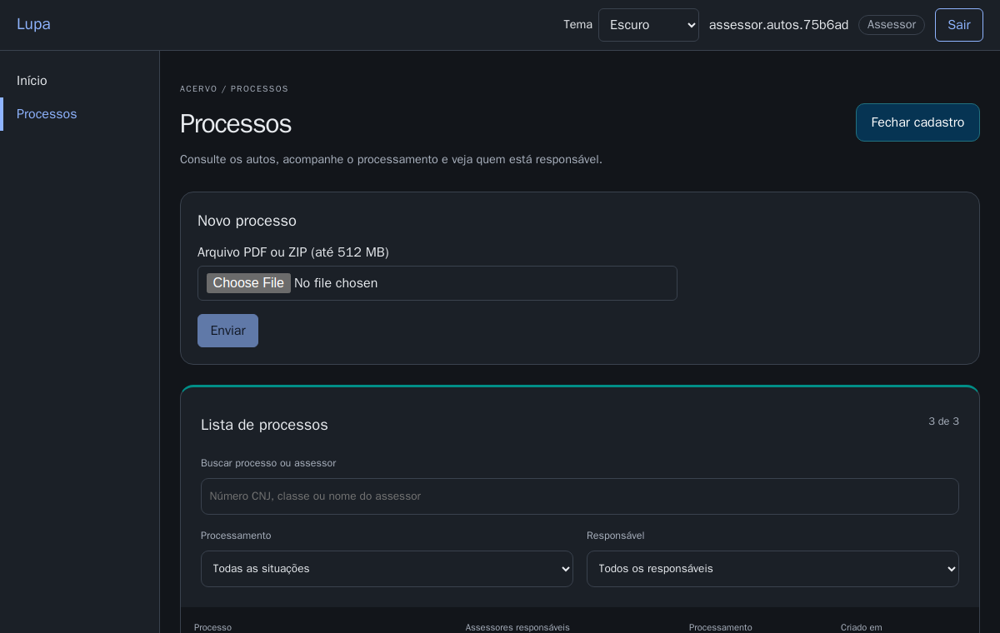
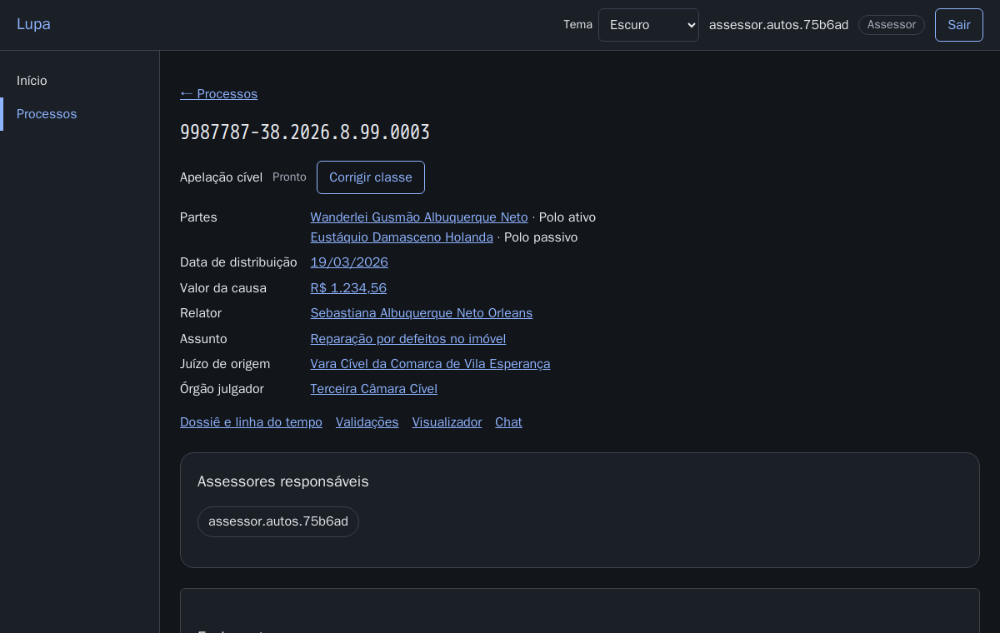
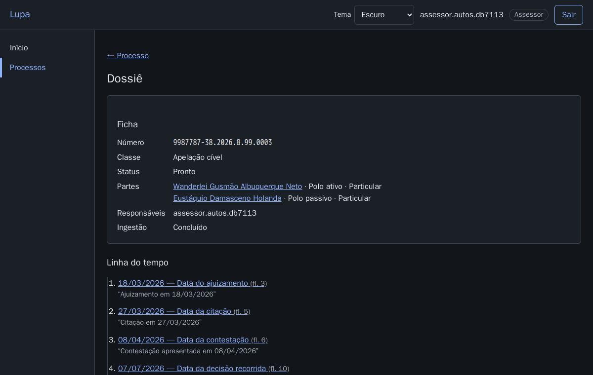
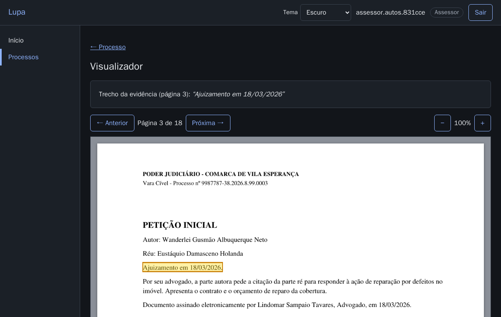
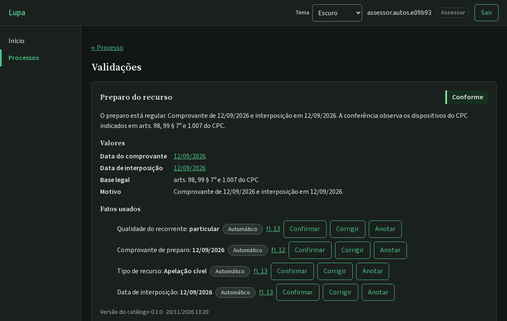
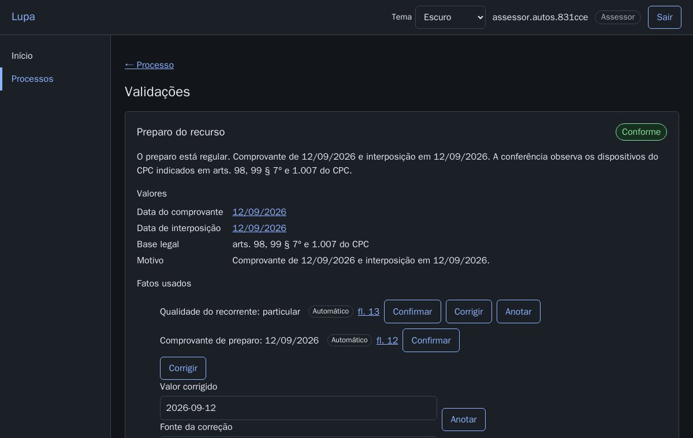
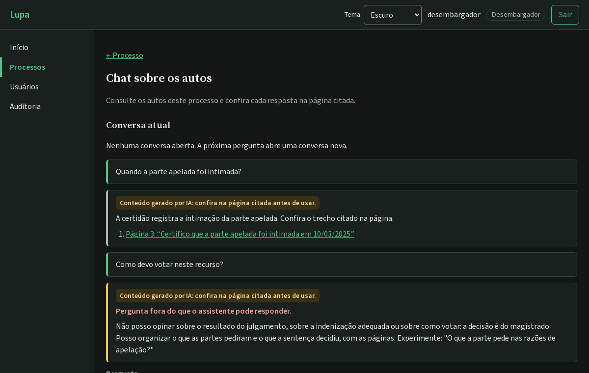

# Guia do assessor

O Lupa organiza os autos cíveis do gabinete e mostra de onde saiu cada informação. Use-o para localizar documentos, conferir datas, examinar o preparo e a representação e refazer uma contagem. A avaliação da prova, a admissibilidade e a redação de atos cabem à equipe do gabinete.

## Entrar e localizar o processo

1. Use a credencial entregue pelo desembargador. No primeiro acesso, configure o autenticador com o código mostrado e confirme o TOTP. Troque a senha temporária quando solicitado. Se perder o autenticador, peça a redefinição ao desembargador.
2. Abra **Processos**. Para consultar, pesquise o número CNJ. Para cadastrar, selecione **Novo processo**, escolha o PDF ou ZIP dos autos e clique em **Enviar**. O Lupa lê o número e a classe na capa. Se pedir um complemento, confira o que foi lido, preencha o campo solicitado e confirme o reenvio. O arquivo continua selecionado. Se o número já existir, o Lupa abre esse processo e informa se o arquivo foi anexado ou já tinha sido enviado.
3. Na tela do processo, acompanhe a ingestão. Depois do processamento, confira as partes, os polos e os dados da capa pelas evidências. Use **Corrigir classe** se necessário. A alteração registra a classe anterior, o autor e a data, e atualiza as validações. Para juntar mais autos, use **Enviar autos**. Em caso de quarentena, leia o motivo. Em processamento parcial, consulte o relatório para saber quais páginas faltaram.

## Encontrar a prova na página

No **Dossiê**, localize a parte, o polo, a peça ou o fato da linha do tempo. Abra a evidência e confira o trecho no visualizador, observando a página e a região destacada quando houver coordenadas. Compare o texto extraído com a imagem original, em especial numa digitalização pouco legível. Uma marca de conteúdo suspeito identifica texto que pode interferir na leitura automática.

## Conferir uma validação

**Conforme** indica que a regra encontrou os requisitos documentais e os valores compatíveis. **Atenção** aponta uma divergência identificada, como interposição após o vencimento ou ausência de comprovante. **Verificar** pede exame humano por ausência, conflito de fontes ou hipótese jurídica indeterminada. Leia a regra, o recorrente, os valores, a base legal e as páginas. Uma ação originária tem dossiê e fatos, com catálogo de validações vazio.

- **Tempestividade.** Confira na certidão a intimação daquele recorrente e no recurso a interposição. Exclua o dia da intimação. Conte dias úteis pulando as datas indicadas no calendário e a suspensão do prazo. Verifique a espécie do recurso e eventual dobra pela qualidade da parte. No exemplo sintético, a intimação de um particular ocorreu em 03/08/2026. O primeiro dia útil foi 04/08, o 15º foi 24/08 e o protocolo em 25/08 ficou um dia útil depois.
- **Preparo.** Abra a guia e compare a data de recolhimento com a interposição. Confira a parte beneficiada se houver dispensa ou gratuidade. Um pedido pendente pede conferência da decisão. O valor das custas exige exame separado.
- **Representação.** Na assinatura do recurso, confira o nome e a OAB. Abra a procuração e os substabelecimentos indicados e siga a cadeia desde o recorrente até o subscritor.
- **Cabimento do agravo.** Abra a decisão interlocutória e confira se o trecho corresponde ao inciso indicado. Quando a hipótese exige interpretação, o resultado é verificar.

## Registrar uma correção

Em **Validações**, abra o fato usado. Confirme o valor se ele coincidir com a fonte. Para corrigir, informe o valor correto e identifique a evidência literal com a página e os offsets pedidos. O sistema confere o trecho e preserva a versão anterior. Consulte o histórico para verificar o efeito nos achados. Um novo processamento conserva a revisão humana.

Se encontrar uma peça classificada incorretamente no índice do dossiê, anote o arquivo, o tipo e o intervalo corretos. A reclassificação está disponível pela API autenticada em `POST /api/processos/{id}/pecas/{peca_id}/reclassificar`, com os campos `tipo`, `origem`, `pagina_inicial` e `pagina_final`. O gabinete pode encaminhar essas referências à pessoa que opera a API.

## Conversar sobre os autos

Perguntas como “Em que página está a procuração do recorrente?” e “Quais datas foram usadas para calcular o prazo da apelação?” permitem conferir a resposta diretamente na fonte. Abra cada citação relevante. Se a resposta indicar falta de evidência, procure o documento no índice. O chat recusa pedidos de minuta, estratégia ou conclusão sobre o mérito. Atingir um teto de uso gera aviso. Se o chat entrar em revisão, informe o desembargador.

Os trechos consultados podem incluir nomes reais e dados de processo sigiloso e podem ser enviados ao fornecedor externo do modelo. Siga as condições de uso acordadas com o tribunal. A auditoria registra atos, horários, identificadores e uso do modelo. Mensagens e páginas têm armazenamento cifrado próprio. [Condições de tratamento](../conformidade/CONFORMIDADE.md).
