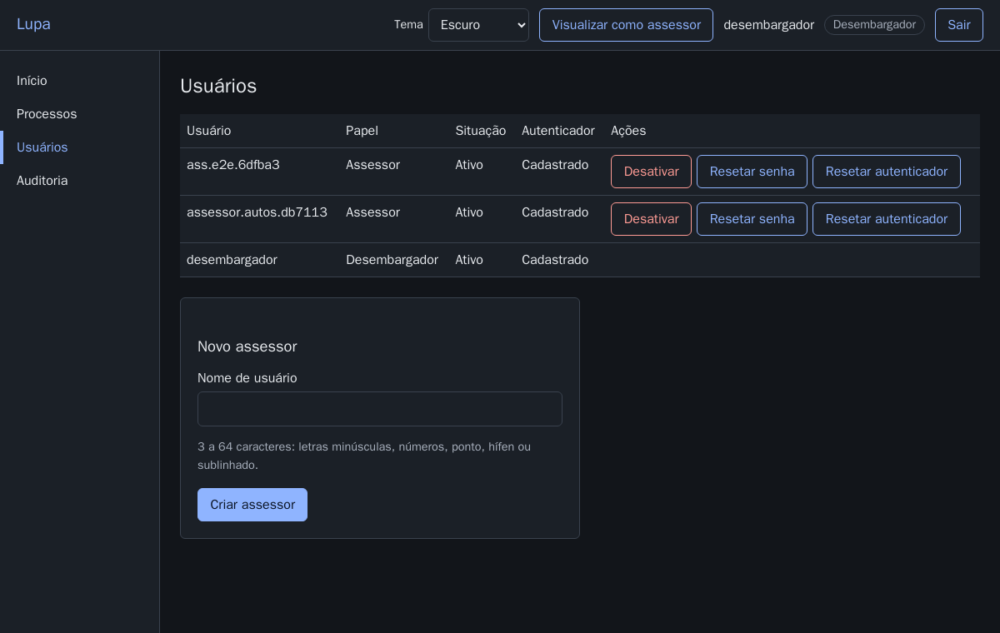
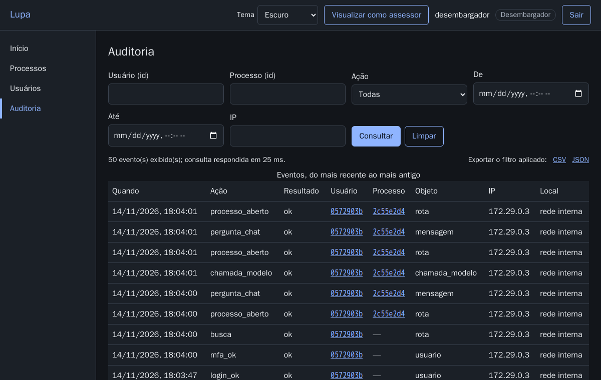
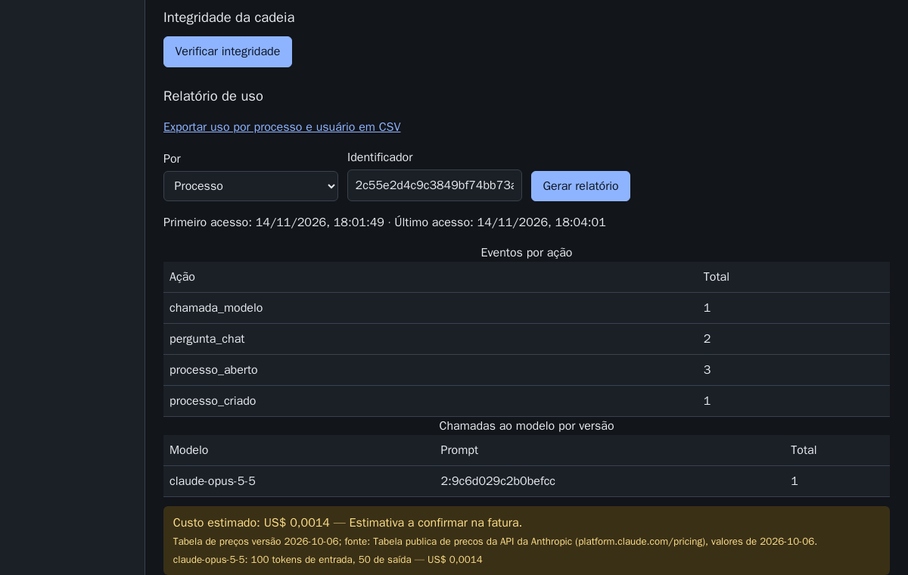

# Guia do desembargador

O desembargador pode consultar processos, conferir fatos e citações, corrigir evidências e usar o chat pelos mesmos passos do [guia do assessor](guia-assessor.md). Também administra assessores, distribui responsáveis, examina a auditoria, libera o chat em revisão e decide sobre descarte.

## Dar acesso e distribuir processos

Na tela **Usuários**, crie o assessor e entregue a credencial temporária por canal combinado. A pessoa registra o próprio autenticador no primeiro acesso. Use **Desativar** para encerrar o acesso e **Reativar** para restabelecê-lo. Em caso de perda de credencial, redefina a senha ou o MFA conforme o caso. As sessões anteriores são revogadas. O responsável técnico cria a primeira conta de desembargador fora da interface.

Na tela do processo, escolha os responsáveis entre os assessores ativos e salve a distribuição. Todos os usuários ativos do gabinete consultam o acervo cível, inclusive quando os autos contêm dados sigilosos. Confira quem mantém acesso antes de admitir material sujeito a sigilo. [Gestão das contas](../operacao/operacao.md).

## Examinar uma resposta bloqueada

Abra o processo em revisão e consulte o motivo e as informações do evento. Confira a página de origem de qualquer trecho suspeito. Enquanto a revisão estiver ativa, uma nova pergunta exibe o aviso e o sistema preserva os limites da conversa. Ao concluir a apuração, use **Liberar revisão**. A autorização fica no histórico de auditoria.

Ao avaliar um achado, refaça a conta a partir das evidências e do calendário da classe. O chat oferece consulta documental. A conclusão de admissibilidade, a valoração da prova e a redação da decisão são atos do gabinete. [Como refazer tempestividade, preparo e representação](guia-assessor.md#conferir-uma-validação).

## Auditoria e relatório ao tribunal

Em **Auditoria**, filtre por período, usuário, processo ou ação. Consulte a localização registrada quando o evento apontar uma página ou trecho. Use **Verificar integridade** para conferir a cadeia cronológica. Se surgir posição inconsistente, preserve a exportação e encaminhe a ocorrência ao responsável técnico.

No relatório de uso, escolha o usuário ou processo e confira contagens, tokens e custo estimado. Para prestação de informações, exporte o período em CSV e registre a versão da ferramenta e do modelo. Use o [modelo de relatório](../conformidade/CONFORMIDADE.md#relatorio-uso-tribunal) para identificar o período, a finalidade e as medidas de supervisão humana.

## Descartar um processo

Antes de acionar o descarte, confira o número CNJ e o processo selecionado. O descarte torna o conteúdo, as correções, as anotações e as conversas inacessíveis e elimina o envelope da chave. Os eventos e os vínculos técnicos permanecem para auditoria. Se houver aviso de limpeza pendente no storage, acione novamente a operação para concluir a remoção dos objetos. A implantação de desenvolvimento não dispõe de backup. [Procedimento operacional](../operacao/operacao.md#descarte).
